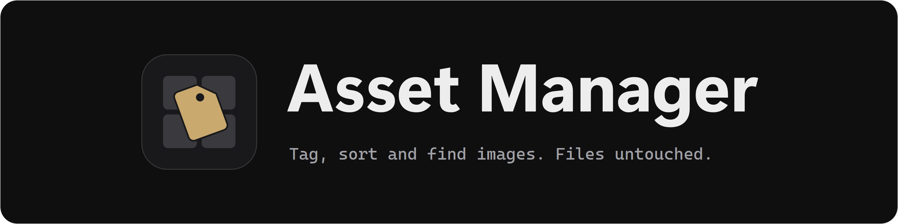
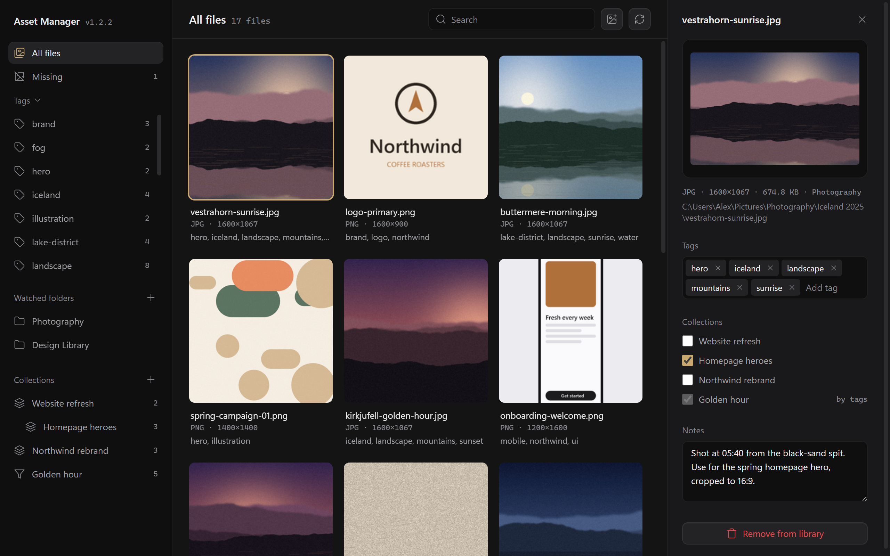
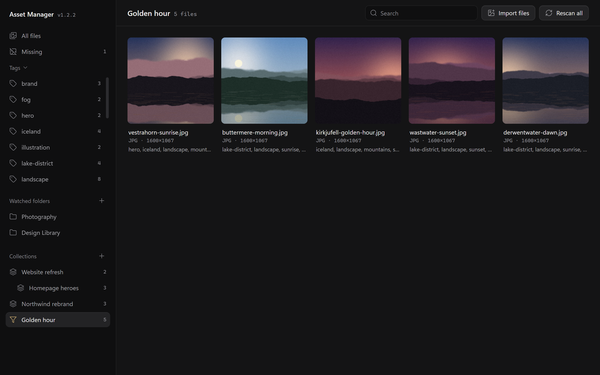
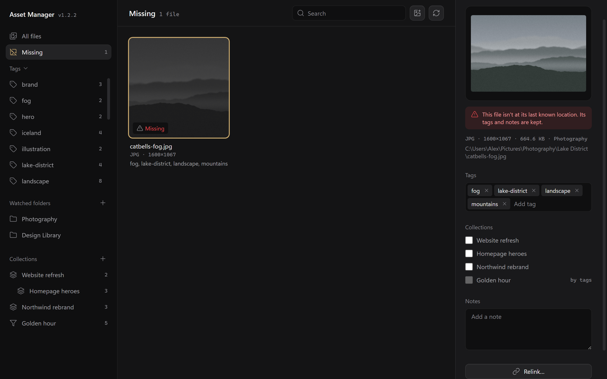

A desktop app for organising your image and design-asset folders with **tags, notes and collections**, without ever moving, renaming or modifying your original files.

Point it at the folders you already use and it builds a browsable, searchable library on top of them. Everything it knows about your files lives in its own data folder, so your source folders stay exactly as they are.

<picture>
  
</picture>

## Download and install

Get the latest build from the [Releases page](https://github.com/TariqMK/Asset-Manager/releases). There's nothing to install: unzip it and run it.

| Platform | Download | Run |
| --- | --- | --- |
| Windows 10 / 11 | `AssetManager-vX.Y.Z-windows-x64.zip` | Unzip, open the `AssetManager` folder, run `AssetManager.exe` |
| macOS (Apple Silicon) | `AssetManager-vX.Y.Z-macos-arm64.zip` | Unzip and open `AssetManager.app` |
| Linux (x64) | `AssetManager-vX.Y.Z-linux-x64.tar.gz` | Extract and run `AssetManager/AssetManager` |

### Windows

- Keep the whole `AssetManager` folder together. `AssetManager.exe` needs the `_internal` folder next to it, so move the folder, not just the exe. To launch it from the Start menu or desktop, make a shortcut to the exe.
- Put the folder somewhere you can write to, like `Documents` or another drive, not `Program Files`. Your library is saved next to the app.
- The app isn't code-signed, so Windows SmartScreen may say *Windows protected your PC* the first time. Click **More info** → **Run anyway**.
- The window uses the Microsoft Edge WebView2 runtime. It comes with Windows 11 and up-to-date Windows 10. If the window opens blank, install it from [Microsoft](https://developer.microsoft.com/microsoft-edge/webview2/).

### macOS

- The app isn't signed with an Apple Developer certificate yet, so macOS blocks it the first time. Right-click `AssetManager.app` → **Open** → **Open**, or run `xattr -cr AssetManager.app` in Terminal.
- Move it into `Applications` if you like. Your library is stored separately (see [Where your library is stored](#where-your-library-is-stored)), so moving or replacing the app doesn't affect it.

### Linux

- Keep the extracted `AssetManager` folder together and run `AssetManager/AssetManager`. Like on Windows, the library is saved next to the app.

## Getting started

1. Open the app and click **Add a folder**.
2. Pick a folder of images and choose whether to include its subfolders. The scan runs in the background, with progress in the bottom-right corner.
3. Click any image to open its details panel, then add tags, notes and collections.

Nothing on disk is moved or changed at any point. Asset Manager only reads your images to make previews.

**Supported formats:** PNG, JPG/JPEG, GIF, WebP, BMP, TIFF and SVG. SVG files are listed and taggable but show a placeholder instead of a preview.

## Screenshots

A smart collection. It collects every landscape tagged *sunrise* or *sunset*, and updates as you tag.

<picture>
  
</picture>

The **Missing** view. A file that was moved outside the app keeps its tags and notes, and **Relink…** points it at the new location.

<picture>
  
</picture>

## Features

- **Non-destructive.** Your files are never moved, renamed, edited or deleted. Removing something from the library only removes Asset Manager's record of it.
- **Watched folders.** Add any folder, on a local disk, an external drive or a network share, with or without its subfolders. Rescan any time to pick up new files.
- **Import individual files.** Drag images onto the window, or use **Import files**, to add files that live outside your watched folders.
- **Tags and notes.** Tag any image and attach free-form notes. Click a tag in the sidebar to filter by it.
- **Collections.** Group files into a nested tree of collections, independent of where they live on disk. A file can be in as many collections as you like.
  - **Manual collections:** you pick exactly which files belong.
  - **Smart collections:** files are included automatically by tag rules, such as *any* or *all* of some tags, with several rules combined by *and* or *or*. They update as you tag.
- **Search** by filename, tag or note text.
- **Missing-file tracking.** If a file disappears from its last known location, its tags and notes are kept and it's listed under **Missing**. Use **Relink…** to point it at the new location.
- **Offline drives.** If a whole watched folder can't be reached, for example an unplugged drive, it's marked *offline* in the sidebar instead of every file being flagged as missing.

## Using Asset Manager

| Task | How |
| --- | --- |
| Add a folder to watch | Click **+** next to *Watched folders*, pick a folder and choose whether to include subfolders |
| Import individual images | Drag them onto the window, or click **Import files** |
| Pick up new or changed files | Click **Rescan all**, or hover a folder in the sidebar and click its rescan button |
| Stop watching a folder | Hover it in the sidebar and click **×**. The files on disk are untouched, but their tags and notes are forgotten |
| Tag or annotate an image | Click it to open the details panel, then add tags and notes |
| Filter by tag | Click a tag in the sidebar. Clear it with the **×** next to the view title |
| Create a collection | Click **+** next to *Collections* and choose *Manual* or *Smart* |
| Add a sub-collection, rename or delete | Hover the collection in the sidebar and use its buttons |
| Add an image to a collection | Tick the collection in the image's details panel |
| Find files that have moved | Open **Missing** in the sidebar, select a file and click **Relink…** |
| Stop tracking a file | Click **Remove from library** in the details panel. The file itself is untouched |
| Close the details panel | Click **×** or press **Esc** |

## Where your library is stored

Your tags, notes, collections and previews are kept in a `library_data` folder:

- **Windows and Linux:** inside the `AssetManager` folder, next to the app
- **macOS:** `~/Library/Application Support/AssetManager/library_data`

```
library_data/
├── library.json        # watched folders and settings
├── collections.json    # your collection tree
├── index/              # per-folder file records (tags, notes, metadata)
└── thumbnails/         # preview images
```

It's all plain JSON, and every save is written in one step, so a crash or power cut can't leave a half-written file behind. Saves are retried briefly if a sync app such as OneDrive or Dropbox has a file locked.

- **Back up:** copy the `library_data` folder.
- **Start fresh:** close the app and delete `library_data`.
- **Move to another computer:** copy the app and its `library_data` folder together. Watched folders are stored by path, so a folder at a different path on the new computer shows as offline. Remove it and add it again.

## Updating to a new version

- **Windows and Linux:** your library lives inside the app folder, so carry it across. Close the app, extract the new version, then copy `library_data` from your old `AssetManager` folder into the new one. You can delete the old folder afterwards.
- **macOS:** replace `AssetManager.app` with the new one. Your library is stored outside the app and stays where it is.

The version you're running is shown in the window title and next to the app name in the sidebar.

## Troubleshooting

**Windows: the app shows an error mentioning `Python.Runtime.Loader.Initialize` and doesn't open.**
This affects v1.2.0 and earlier when the zip was extracted with Windows' built-in extractor, which marks every file as downloaded. Run this in PowerShell, using your own folder path, then start the app again:

```powershell
Get-ChildItem "C:\path\to\AssetManager" -Recurse | Unblock-File
```

Or right-click the zip, choose **Properties**, tick **Unblock**, and extract it again. Later versions fix this automatically.

**The window opens but stays blank (Windows).**
Install the [Microsoft Edge WebView2 runtime](https://developer.microsoft.com/microsoft-edge/webview2/).

**A watched folder shows as *offline*.**
The drive or network share isn't connected. Its files keep their tags and aren't marked missing. Reconnect it and click rescan.

**Dragging files onto the window doesn't import them.**
Use **Import files** instead, which always works.

**An image I moved shows as *Missing*.**
Open **Missing** in the sidebar, select it and click **Relink…** to point it at the new location. Its tags, notes and collections are kept. If you moved it into another watched folder, a rescan lists it there as a new file instead.

---

## For developers

### Run from source

Requires Python 3.10 or newer. It's developed on Python 3.14, on Windows. On Linux, also install the Qt backend with `pip install "pywebview[qt]"`.

```bash
git clone https://github.com/TariqMK/Asset-Manager.git
```

```bash
cd Asset-Manager
```

```bash
python -m venv venv
```

```bash
venv\Scripts\activate
```

```bash
pip install -r requirements.txt
```

```bash
python app.py
```

When run from source, the library is kept in `library_data` next to `app.py` and the version shows as `dev`.

### Build it yourself

PyInstaller doesn't cross-compile, so build on the operating system you're building for:

```bash
pip install pyinstaller
```

```bash
python build.py
```

The build goes to `dist/AssetManager/` on Windows and Linux, or `dist/AssetManager.app` on macOS. Every build is stamped with a version: set the `VERSION` environment variable to choose it, otherwise it comes from `git describe`, for example `0.3.0-2-g1a2b3c4` for two commits after the `v0.3.0` tag.

### Update the screenshots

The README screenshots come from the real app, filled with made-up sample images in a temporary folder. Your own `library_data` is not read or changed. Retake them after any change to the interface:

```bash
pip install -r requirements.txt PySide6
```

```bash
python assets/make_screenshots.py
```

The script stops without saving if a section of the details panel is squeezed, or if your user name, computer name or a real path shows on the page.

### Update the icon, banner and social card

All brand images come from the icon masters in `assets/icon/`. To rebuild the `.png`, `.ico` and `.icns` icons, `assets/banner.png` and `assets/social-card.png`, run this on Windows. It needs PySide6 and Pillow, installed in the step above:

```bash
python assets/make_assets.py
```

**Note:** The social card is a repository setting. To change it on GitHub, open **Settings**, then under **General** go to **Social preview** and upload `assets/social-card.png`.

### Releasing

Releases are built by a GitHub Actions workflow that only runs when started by hand:

1. Go to **Actions → Release → Run workflow**.
2. Choose **draft** or **public**, and whether this is a **major**, **minor** or **patch** release.

The workflow works out the next version from existing tags and releases (drafts included), builds for Windows, macOS and Linux, then tags the commit and creates the release with all three builds attached. Nothing is tagged unless all three builds succeed.

### Built with

- [Flask](https://flask.palletsprojects.com/): local API serving the interface
- [pywebview](https://pywebview.flowrl.com/): native desktop window
- [Pillow](https://python-pillow.org/): thumbnail generation
- Plain HTML, CSS and JavaScript for the interface, with icons from [Lucide](https://lucide.dev/)

### Contributing

Issues and pull requests are welcome. If you're planning a larger change, please open an issue first to discuss it.
